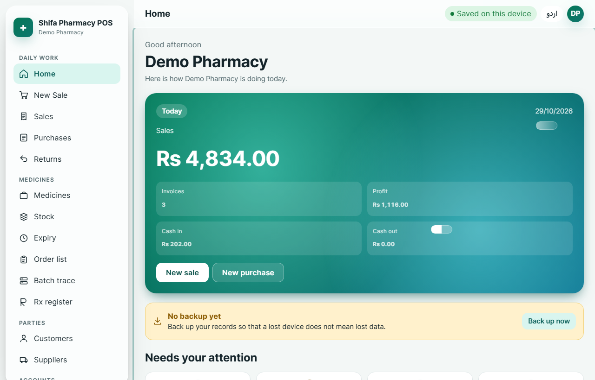
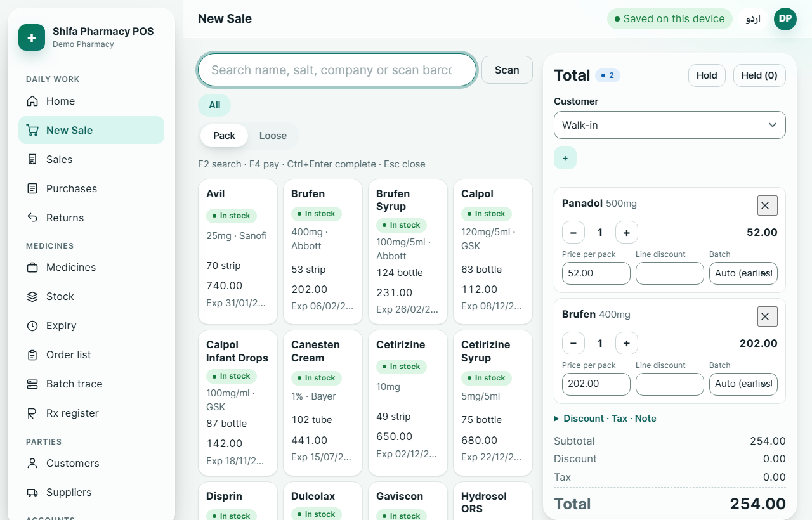
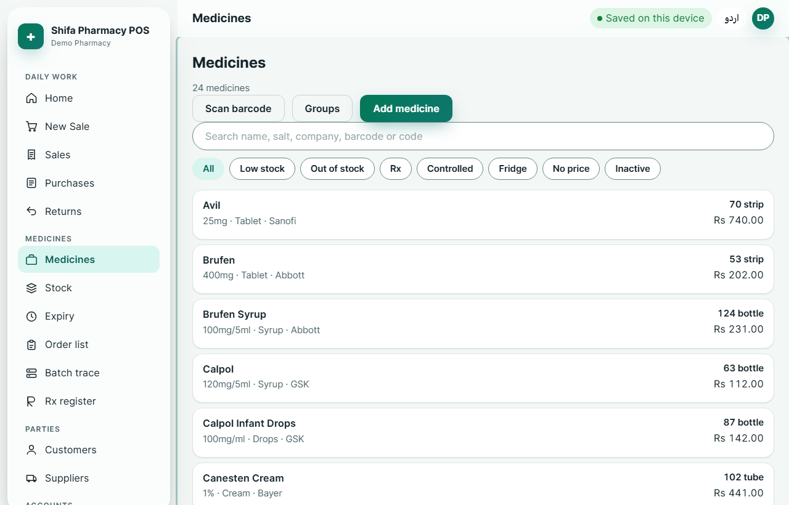
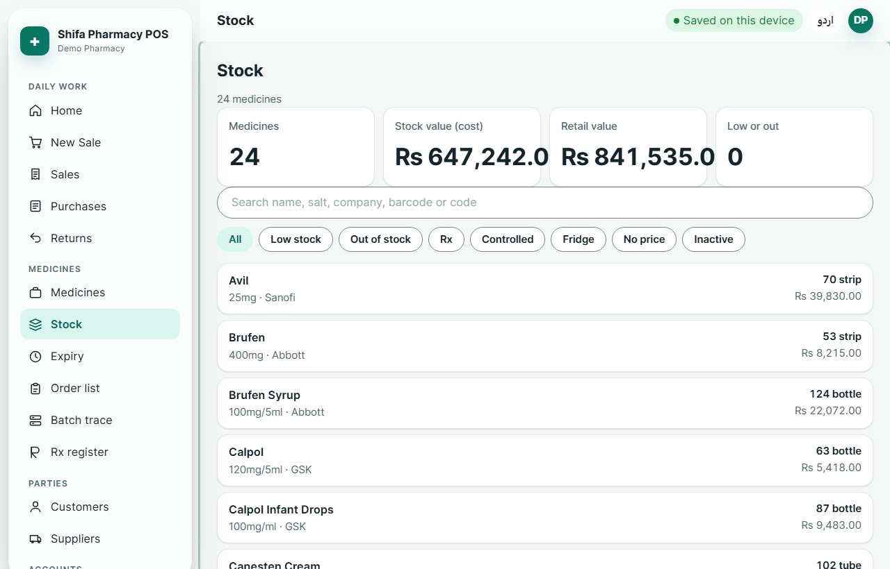
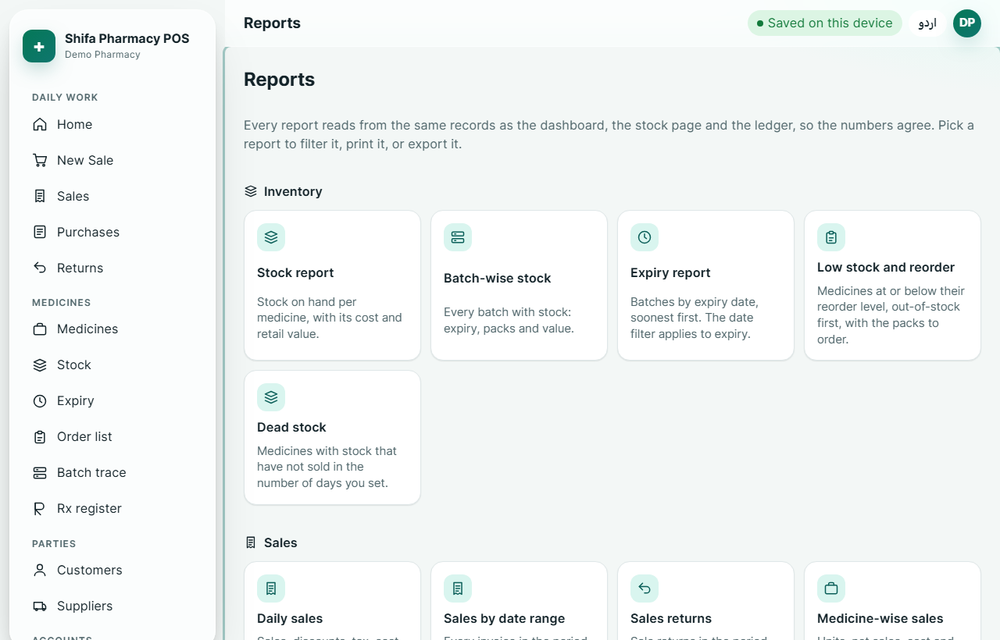
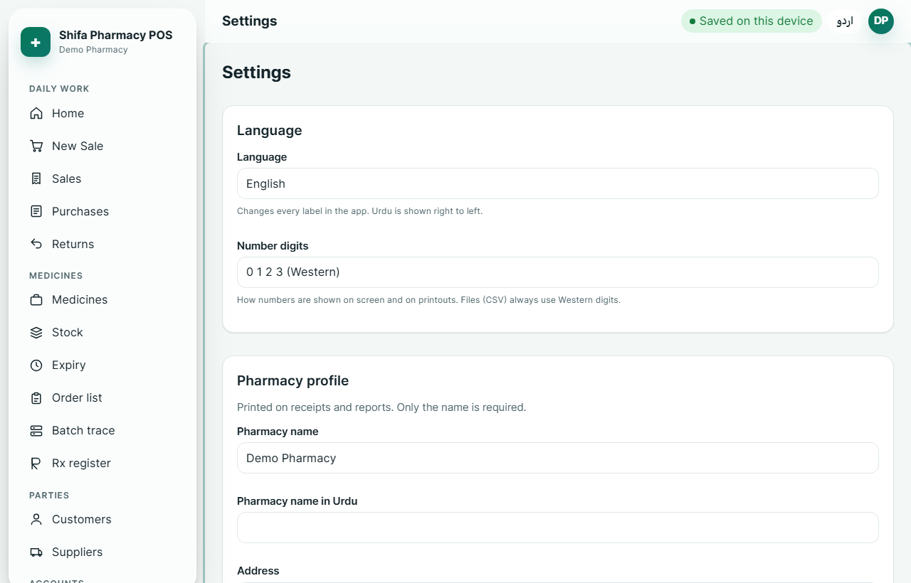
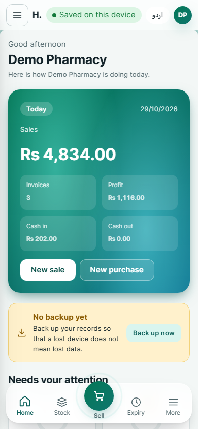
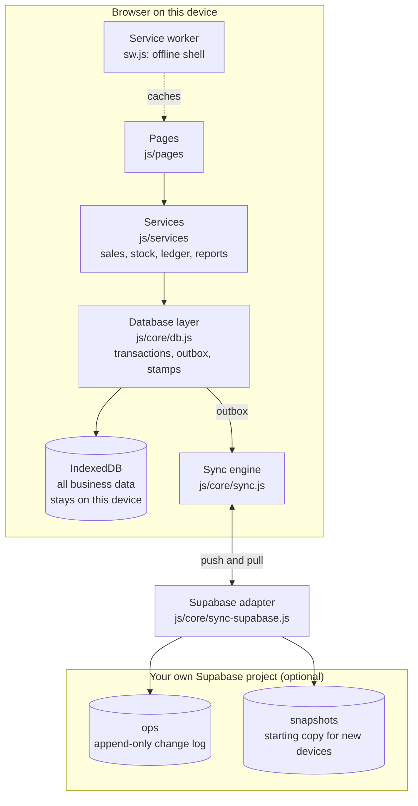

# Shifa Pharmacy POS

An offline-first point of sale and stock system for pharmacies. It runs in any modern browser, works with no connection, and is built with plain HTML, CSS and JavaScript: no framework, no build step, no server of our own.

> **Where your data lives.** Business data (medicines, stock, sales, purchases, customers, ledger) is stored **on the device** in the browser's IndexedDB. If you choose, the device also sends its changes to **your own Supabase project**, which you create and control. **Nothing business-related is stored in this repository.** The repository holds only the application code and documentation.

<!-- Live demo: replace with your Pages address once it is published, e.g. https://<user>.github.io/<repo>/ -->

## Screenshots

| Home | New sale |
|---|---|
|  |  |

| Medicines | Stock by batch |
|---|---|
|  |  |

| Reports | Settings |
|---|---|
|  |  |

| Phone |
|---|
|  |

The screenshots show demo data (Settings → App and data → Load demo data). The names are invented.

## Features

**Selling**
- Keyboard-first sale screen: search by name, salt, company or barcode; F2 search, F4 pay, Ctrl+Enter complete.
- Pack and loose selling, line and sale discounts, optional sales tax, several payment methods (cash, card, bank, mobile), change, and customer accounts ("udhaar").
- Hold and resume sales. A discarded hold can be undone.
- Receipts: browser print, or a Bluetooth thermal printer (ESC/POS) where the browser supports it. Urdu text prints correctly.
- Rx and controlled medicines: patient and doctor required, and a register that can be printed.

**Stock and medicines**
- Stock is kept by batch and is never typed in directly: it is the sum of stock movements. Sales use the batch that expires first.
- Expiry list, low stock, order list (suggested packs for the sales rate), batch trace (which customers got a batch), stock recalculation and an integrity check.
- Popular Pakistani medicines can be added as a starting list.

**Purchases, returns and parties**
- Purchases with batches, supplier accounts and payments.
- Sale returns and purchase returns that put stock back and post the ledger.
- Customers and suppliers, with opening balances, statements and reminders.

**Money**
- Double-entry ledger: every document posts balanced entries. The trial balance is checked on every run.
- Cash book (receipts, payments, expenses, income, transfers) and accounts, including bank and wallet accounts.

**Reports**
- 23 reports in a card grid: sales, profit, products, stock value, expiry, purchases, returns, cash and more, with CSV export.
- Daily totals are kept up to date, so reports stay fast with tens of thousands of sales.

**Language and access**
- English and Urdu, with a full right-to-left layout and Urdu numerals as an option.
- Owner login (PBKDF2 password hashing), a session that expires after a set number of hours, and a device ID.

**Backup and sync**
- Backup to one file (download, or share on phones), with a checksum and a schema check. Restore asks for the word RESTORE first.
- Optional sync through your own Supabase project. Works offline, sends changes when the connection returns, and converges across devices. See [Sync setup](#sync-setup-supabase).

**App**
- Installable (PWA) and offline after the first visit. Shows "New version available" when an update is ready.
- Accessible: keyboard navigation, visible focus, labelled controls, reduced-motion switch, and text contrast checked in light and dark themes.

## Architecture

Pages call services; services call the database layer; only the database layer touches IndexedDB. Synced writes are queued in an outbox in the same transaction, and the sync engine sends them when it can.



Key rules, from `CLAUDE.md` and `docs/ARCHITECTURE.md`:

- Money is stored as integer paisa and formatted only for display.
- Stock is the sum of movements; `batches.onHand` is a cache that can be recalculated.
- Every business document posts balanced double-entry ledger lines.
- Document numbers carry a per-device prefix option, so two devices never issue the same number.

More detail: [docs/ARCHITECTURE.md](docs/ARCHITECTURE.md), [docs/DATA_MODEL.md](docs/DATA_MODEL.md), [docs/SYNC.md](docs/SYNC.md), [docs/QUALITY.md](docs/QUALITY.md).

## Data and privacy

- **On the device:** every record, the owner's password hash, the device ID and the sync connection settings are stored in the browser's IndexedDB and local settings. Clearing the site's data deletes them.
- **In your Supabase project, only if you connect sync:** the change log and snapshots of business records. Row-level security limits every request to your pharmacy's account.
- **Not in this repository:** no records, no backups, no keys, no passwords. The Supabase address and anon key are typed into Settings and stay on the device. `.gitignore` also excludes backup files and secrets as a safety net.
- **Passwords are never in backups.** The owner's password is stored only as a salted PBKDF2 hash on the device.

## Quick start

You need a browser and any static file server. The app needs `http://` or `https://` (the service worker does not run from `file://`).

```bash
git clone https://github.com/<user>/<repo>.git
cd <repo>
node tests/serve.mjs            # http://localhost:8787/index.html
```

Or use `python -m http.server 8000` from the repository root. On first run, create the owner account. Then open **Settings → App and data → Load demo data** to see the app with sample records. Use a fresh browser profile for demos, so the demo data never mixes with real records.

## Deploy to GitHub Pages

The repository deploys itself. The workflow in [`.github/workflows/pages.yml`](.github/workflows/pages.yml) publishes the repository root on every push to `main`. It appends the commit SHA to the service worker's cache version, so each deploy starts a fresh cache. All paths are relative, so the app works under `/<repo-name>/`.

1. Push the repository to GitHub.
2. **Settings → Pages → Build and deployment → Source: GitHub Actions.**
3. Push to `main`. The site appears at `https://<user>.github.io/<repo-name>/`.

Pages on a private repository needs a paid GitHub plan. The app does not need a server, so there is nothing else to host.

## Sync setup (Supabase)

Sync is optional. Without it, the app works entirely on the device.

1. **Create a Supabase project** (free tier is enough for a single pharmacy). Note the Project URL and the anon public key under **Settings → API**.
2. **Create the tables and security policies.** In the SQL Editor, run [`docs/supabase.sql`](docs/supabase.sql). It creates the tables and row-level security, so one pharmacy cannot read another's data.
3. **Create the pharmacy's sync account.** Under **Authentication → Users**, add a user with an email and password, then link it to the pharmacy with the two inserts described at the end of `docs/supabase.sql`. Turn off public sign-ups.
4. **Connect the device.** In the app: **Settings → Sync**, enter the Project URL, the anon key, the account email and password, then **Connect and sync**. The password is used once to sign in; only a renewable sign-in is kept on the device.
5. **Set a device prefix** on every device (Settings → Pharmacy rules → Device prefix), so document numbers never clash.

Read [docs/SYNC.md](docs/SYNC.md) for how conflicts are resolved and what sync does not cover. The simulation in `tests/sync-sim.html` shows two offline devices converging.

## Backup advice

Sync is not a backup you can rely on alone: a mistake on one device is copied to the others. Keep your own backups as well.

- **Back up at least weekly.** The dashboard reminds you when a backup is due; set the interval on the Backup screen.
- **Keep the file somewhere else**: a second device, a cloud drive you control, or a printed summary of key figures. Do not keep it only on the device that holds the data.
- **Test a restore** on a spare device at least once. Restore replaces the data on the device, so only restore onto a device you intend to replace.
- **Backup files contain business and customer data.** Treat them like the records themselves. Never put them in this repository or in a public place.

## Project layout

```
index.html               the single page; loads the app module
sw.js                    service worker (offline shell, update flow, Background Sync)
manifest.webmanifest     install metadata and icons
js/core/                 database, router, sync engine, UI helpers, i18n, auth
js/services/             business rules: sales, stock, ledger, reports, backup, demo data
js/pages/                one module per screen
js/i18n/                 English and Urdu strings
css/                     design tokens, layout, components, dark theme, print
docs/                    architecture, data model, sync, quality, Supabase SQL
tests/                   browser test pages, checklist, local server
scripts/                 audits (shell, budget, contrast) and icon generator
.github/workflows/       GitHub Pages deployment
```

## Checks

```bash
node scripts/audit-shell.mjs      # precache list matches the files; version matches
node scripts/audit-budget.mjs     # first-load size and preload block (budget 300 KB gzipped)
node scripts/audit-contrast.mjs   # text contrast, light and dark
node tests/audit-keys.mjs         # every translation key exists in English and Urdu
```

Open these in the browser and check the results they show: `tests/services.test.html` (business rules), `tests/migration.html` (upgrade from schema version 1), `tests/sync-sim.html` (two offline devices converge). Manual scenarios are in [tests/e2e-checklist.md](tests/e2e-checklist.md).

## Status

Version 1.2.0. The business rules and the sync engine are tested automatically (see above). Items not yet verified, and open issues, are listed in [docs/QUALITY.md](docs/QUALITY.md) and [docs/SYNC.md](docs/SYNC.md). In particular: the service worker's offline start was checked in headless Chrome under a `/repo-name/` path (the update prompt and Background Sync have not been run), the Supabase adapter has not been run against a live project, Bluetooth printing and camera scanning have not been tested on hardware, and the Urdu text should be reviewed by a native speaker. Test with your own data and your own printer before relying on it in a pharmacy.

## Contributing

See [CONTRIBUTING.md](CONTRIBUTING.md). The rules are short: vanilla code, no new libraries without discussion, pages → services → database, integer paisa, and a translation for every visible string.

## Changes

See [CHANGELOG.md](CHANGELOG.md).

## License

MIT. See [LICENSE](LICENSE).
